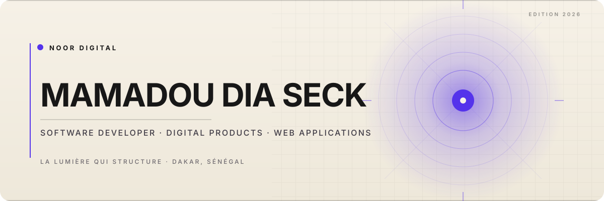

<!-- NOOR DIGITAL | GitHub profile -->

# Mamadou Dia Seck

### Software Developer · Digital Products · Web Applications

**NOOR DIGITAL — La lumière qui structure.**

I turn real needs into useful digital products through thoughtful design, clear engineering and continuous refinement.

[Dakar, Senegal](https://www.google.com/maps/search/?api=1&query=Dakar%2C+Senegal) · [Portfolio](https://noor-digital.github.io/noor-digital-portfolio/) · [Email](mailto:papeseck.dev@gmail.com) · [GitHub](https://github.com/noor-digital)

---

## Profile

I am a software developer based in Dakar, Senegal, interested in building digital products that solve practical problems.

My work spans the product process: understanding a need, shaping the experience, selecting an appropriate technical approach, implementing the solution and refining it.

My core tools include **JavaScript, React, PHP, Laravel and MySQL**. I care about usable interfaces, maintainable code, thoughtful data design and honest technical documentation. AI-assisted tools are part of my workflow when they help accelerate research and implementation; they do not replace engineering judgement.

**NOOR DIGITAL** is my professional identity and the home for my projects, experiments and selected client work.

## Selected work

A focused selection of projects, each linked to its live demonstration and source code.

<table>
<tr>
<td width="50%" valign="top">

### [MANGORA](https://github.com/noor-digital/mangora)

A cinematic manga discovery and reading experience, built as a browser-based frontend demonstration.

- Search, catalogue filters and rankings
- Series pages, chapter reader and reading progress
- Personal library, preferences and responsive interactions

**Stack:** React 18 · JavaScript · Vite · CSS · React Router · Vitest

[Live demo](https://noor-digital.github.io/mangora/) · [Source](https://github.com/noor-digital/mangora)

</td>
<td width="50%" valign="top">

<a href="https://noor-digital.github.io/noor-digital-portfolio/">Open the live portfolio</a>

### [NOOR DIGITAL Portfolio](https://github.com/noor-digital/noor-digital-portfolio)

My multi-page professional portfolio, presenting selected work, services and development approach.

- Dedicated project, service and contact pages
- Responsive interface and reusable components
- Route-specific metadata and generated static pages

**Stack:** React 19 · React Router 7 · Vite 8 · Motion · CSS

[Live portfolio](https://noor-digital.github.io/noor-digital-portfolio/) · [Source](https://github.com/noor-digital/noor-digital-portfolio)

</td>
</tr>
<tr>
<td width="50%" valign="top">

### [NOVA SHOP](https://github.com/noor-digital/nova-shop)

A responsive storefront prototype focused on the shopping interface and client-side state.

- Product search, category and price filters
- Product details, cart and favourites
- Persistent cart, favourites and theme preferences

**Stack:** HTML · CSS · JavaScript ES modules

*Frontend demonstration only: no backend, user accounts or real payment processing.*

[Live demo](https://noor-digital.github.io/nova-shop/) · [Source](https://github.com/noor-digital/nova-shop)

</td>
<td width="50%" valign="top">

### [Aeris Météo](https://github.com/noor-digital/aeris-meteo)

A weather application whose visual atmosphere adapts to the selected location's conditions and time of day.

- City search and browser geolocation
- Current conditions, 24-hour and 7-day forecasts
- Weather-driven backgrounds and canvas effects

**Stack:** HTML · CSS · JavaScript · Canvas · Open-Meteo API

[Live demo](https://noor-digital.github.io/aeris-meteo/) · [Source](https://github.com/noor-digital/aeris-meteo)

</td>
</tr>
</table>

### [Sabaly Consulting](https://github.com/noor-digital/sabaly-consulting)

A static multi-page showcase website created for a client, presenting its services, programmes and references.

**Stack:** HTML · CSS · Bootstrap 5 · JavaScript

[Live website](https://sabaly-consulting-green.vercel.app/) · [Source](https://github.com/noor-digital/sabaly-consulting)

## In development

### [LearnHub — Learning Management Platform](https://github.com/noor-digital/-learnhub)

An ongoing Laravel application exploring the management of training activity, including users and roles, courses, enrolments, lessons and assessments.

**Current stack:** PHP · Laravel 12 · MySQL / MariaDB · JavaScript · Alpine.js · Vite · Tailwind CSS

The intended product direction is a multi-institution SaaS platform. Multi-tenancy remains a planned architectural direction; it is not presented as an already delivered capability.

## Technical toolkit

| Focus | Technologies |
|---|---|
| **Frontend** | JavaScript · React · HTML5 · CSS3 · Tailwind CSS · Bootstrap |
| **Backend** | PHP · Laravel |
| **Data** | MySQL |
| **Engineering tools** | Git · GitHub · VS Code · Composer · Postman · Vite |
| **Design & workflow** | Figma · Canva · Laragon · XAMPP |

## Engineering approach

- **Understand first** — clarify the problem before selecting a technology.
- **Design intentionally** — prioritize usability, accessibility and consistency.
- **Build with structure** — separate responsibilities and keep code maintainable.
- **Validate behaviour** — test key flows, errors and edge cases.
- **Document honestly** — distinguish shipped functionality from limitations and plans.
- **Improve continuously** — turn research and learning into working software.

## Background

- **Studies:** Licence 2 in Computer Science — Web, Mobile and Gaming Application Development, Université Virtuelle du Sénégal.
- **Training:** Full Stack Web Development — 10H Tech.

## Connect

For a project, a technical discussion or a meaningful opportunity:

- **Email:** [papeseck.dev@gmail.com](mailto:papeseck.dev@gmail.com)
- **Portfolio:** [noor-digital.github.io/noor-digital-portfolio](https://noor-digital.github.io/noor-digital-portfolio/)
- **GitHub:** [github.com/noor-digital](https://github.com/noor-digital)

---

**NOOR DIGITAL — La lumière qui structure.**

Built with curiosity, discipline and a commitment to thoughtful work. · Dakar, Senegal 🇸🇳

