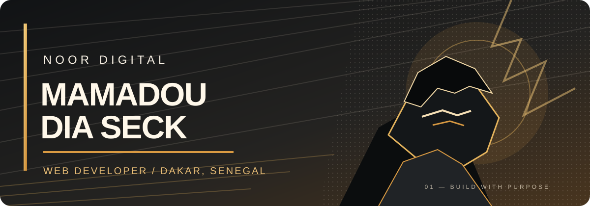

<!-- NOOR DIGITAL | Manga-inspired profile | Original artwork -->

### **NOOR DIGITAL — La lumière qui structure.**

---

*Un parcours. Des défis. Des projets. Et toujours un nouveau chapitre à écrire.*

## ✦ CHAPITRE 01 — Le développeur

Je suis **Mamadou Dia Seck**, développeur web basé à **Dakar, Sénégal**, et étudiant en informatique à l'Université Virtuelle du Sénégal.

J'aime construire des expériences numériques utiles, soigner les détails d'interface et transformer une idée en produit concret. Avec **NOOR DIGITAL**, je développe une identité qui associe créativité, rigueur et technologie.

- 🎓 **Études :** Licence 2 en informatique — UVS
- 💻 **Formation :** développement web Full Stack — 10 TECH
- ⚛️ **Frontend :** React, JavaScript, HTML, CSS
- 🧩 **Backend :** PHP, Laravel, MySQL
- 🎯 **En quête de :** projets concrets, stages et opportunités junior
- 🤝 **Ouvert aux :** collaborations et échanges professionnels

## ⚡ CHAPITRE 02 — Arsenal technique

**FRONTEND**

**BACKEND & DATA**

**OUTILS**

## 📚 CHAPITRE 03 — Projets à découvrir

| Projet | Ce que j'ai construit | Dépôt |
|:--|:--|:--:|
| **MANGORA** | Plateforme manga : découverte et lecture | [Ouvrir ↗](https://github.com/noor-digital/mangora) |
| **NOVA SHOP** | Interface e-commerce, catalogue et panier | [Ouvrir ↗](https://github.com/noor-digital/nova-shop) |
| **Aeris Météo** | Météo interactive et prévisions | [Ouvrir ↗](https://github.com/noor-digital/aeris-meteo) |
| **Sabaly Consulting** | Site vitrine professionnel pour un client | [Ouvrir ↗](https://github.com/noor-digital/sabaly-consulting) |
| **Expense Tracker** | Suivi des dépenses et budget | [Ouvrir ↗](https://github.com/noor-digital/expense-tracker) |
| **Vocal Queue System** | File d'attente avec annonces vocales | [Ouvrir ↗](https://github.com/noor-digital/vocal-queue-system) |

## 📈 CHAPITRE 04 — Progression

## 🧭 CHAPITRE 05 — Quêtes actuelles

- Concevoir des interfaces modernes, accessibles et responsive.
- Développer des applications avec React et des solutions Full Stack.
- Renforcer mes compétences en Laravel, API et qualité du code.
- Transformer chaque apprentissage en réalisation concrète.

## 🌙 PROCHAIN CHAPITRE — Construisons quelque chose

**Une idée, une collaboration ou une opportunité ? Échangeons.**

**NOOR DIGITAL — La lumière qui structure.**

Créativité · Discipline · Développement · Dakar, Sénégal 🇸🇳

Fin du chapitre ? Jamais. La suite s'écrit à chaque commit. ✦

